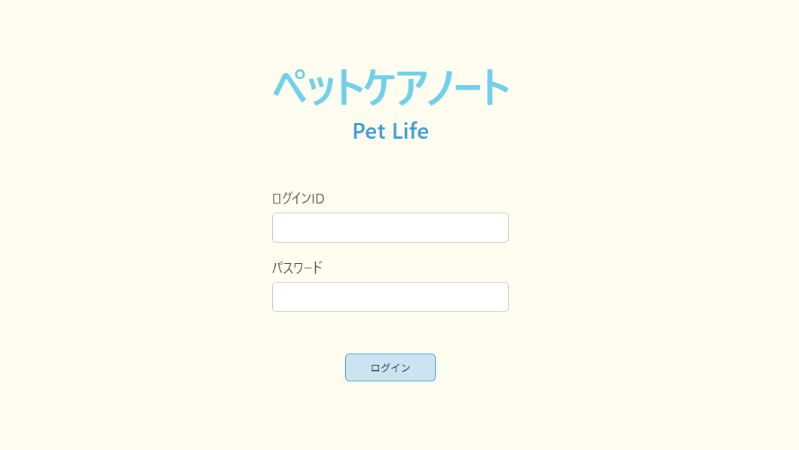
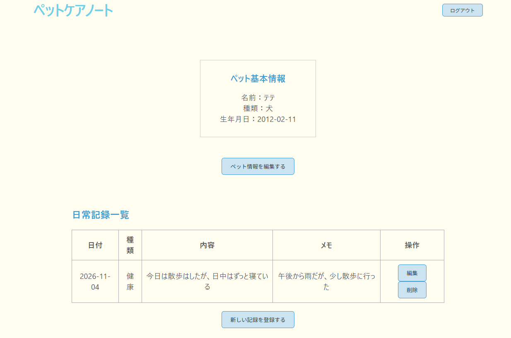
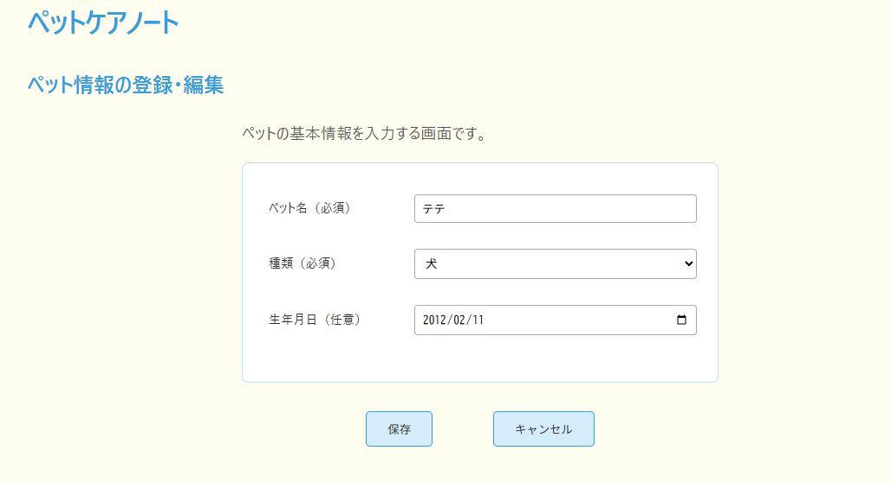
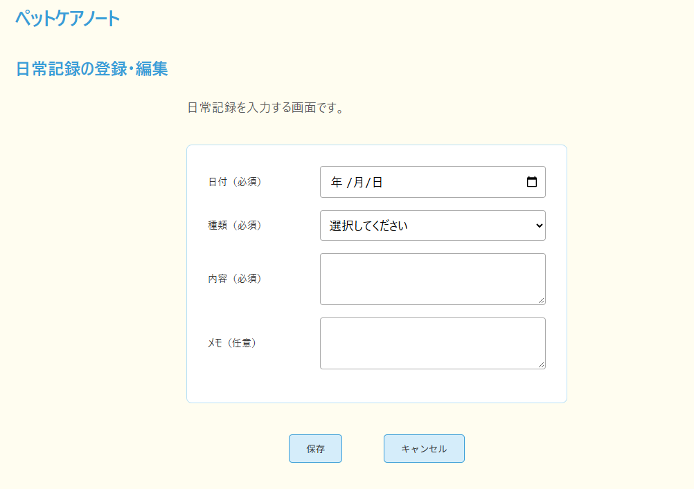
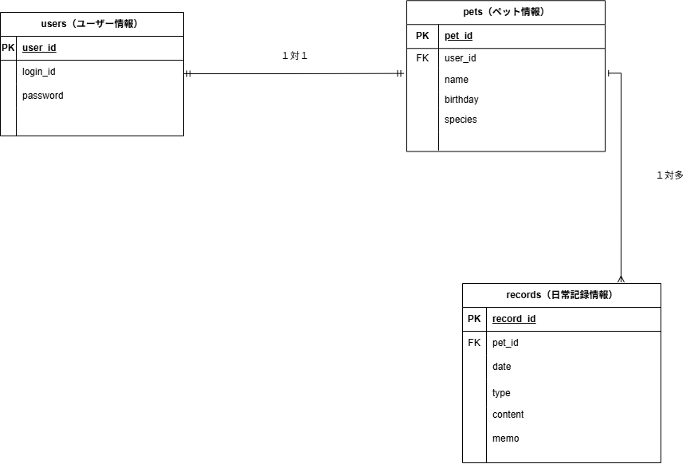

# アプリ名：ペットケアノート

・大切なペットの日常を、簡単に記録・管理できるWEBアプリです。

## アプリケーションの概要

・ペットの基本情報や日々の体調管理・生活の記録を管理できるアプリです。
・ログイン後、ペット情報の確認や日常記録の登録・編集・削除ができます。

## 開発した背景・理由

・ペットの日々の管理用をメインに、日頃の様子や健康状態を簡単に記録できるアプリを作りたいと考えました。
・操作が苦手な方でも使いやすいように、必要な機能をメインにシンプルな画面構成を意識しました。

## アプリケーションのURL

・本番環境への公開は行っていません。ローカル環境で動作します。

## デモ画像

### ログイン画面 

・ログインIDとパスワードを入力し、アプリにログインできます。

### ペット記録画面 

・ペットの基本情報と日常記録の一覧を確認できます。記録の編集・削除ができます。

### ペット情報の登録・編集画面 

・ペットの名前・種類（プルダウン選択式）・生年月日を登録・編集ができます。

### 日常記録の登録・編集画面 

・日付・種類（プルダウン選択式）・内容・メモを入力し、日常記録を登録・編集できます。

## 主な使用技術

- フロントエンド：React、JavaScript、CSS、Vite
- バックエンド：Java、Spring Boot
- データベース：MySQL
- 開発環境：Docker、VS Code、IntelliJ IDEA
- バージョン管理：Git、GitHub

## 主な機能

- ログイン・ログアウト
- ペット情報の登録・表示・編集
- 日常記録の登録・一覧表示・編集・削除

## 工夫した点

- 初めて利用する方でも分かりやすい画面構成
- 必要な機能を絞ったシンプルな操作
- ペット情報と日常記録を分けた画面設計

## 開発で苦労した点

・ReactからSpring BootのAPIを呼び出し、データベースに保存した内容を画面へ反映する部分です。
・登録・編集・削除の動作を一つずつ確認しながら実装しました。

## ER図 

・ユーザー情報、ペット情報、日常記録の3つのテーブルでデータを管理しています。

## ローカル環境での起動方法

・インストール手順

### 1. リポジトリをクローン

git clone https://github.com/cocokarin/pet-care-note.git
cd pet-care-note

### 2. データベースの設定

プロジェクト直下に `.env` ファイルを作成し、MySQLのパスワードを設定します。

```env
MYSQL_ROOT_PASSWORD=任意の管理者用パスワード
MYSQL_PASSWORD=任意のデータベース用パスワード


### 3. データベース（MySQL）を起動

Docker Desktopを起動し、以下のコマンドを実行します。

docker compose up -d


MySQLは `localhost:3312` で起動します。

### 4. バックエンド（Spring Boot）を起動

別のターミナルで実行します。

cd backend
.\mvnw.cmd spring-boot:run


バックエンドは `http://localhost:8080` で起動します。

### 5. フロントエンド（React）を起動

別のターミナルを開き、プロジェクト直下から実行します。

cd frontend
npm install
npm run dev


表示されたURL（通常は `http://localhost:5173`）をブラウザで開きます。

### 6. アプリケーションを操作

ログイン後、ペットの基本情報や日常記録の登録・表示・編集・削除を行えます。
```
